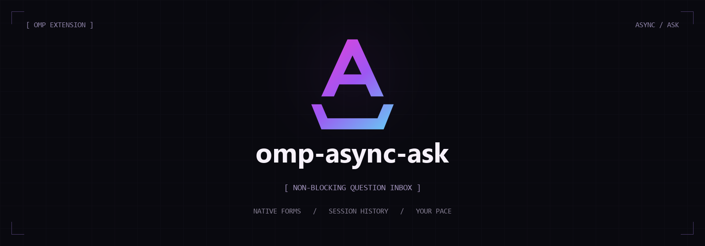
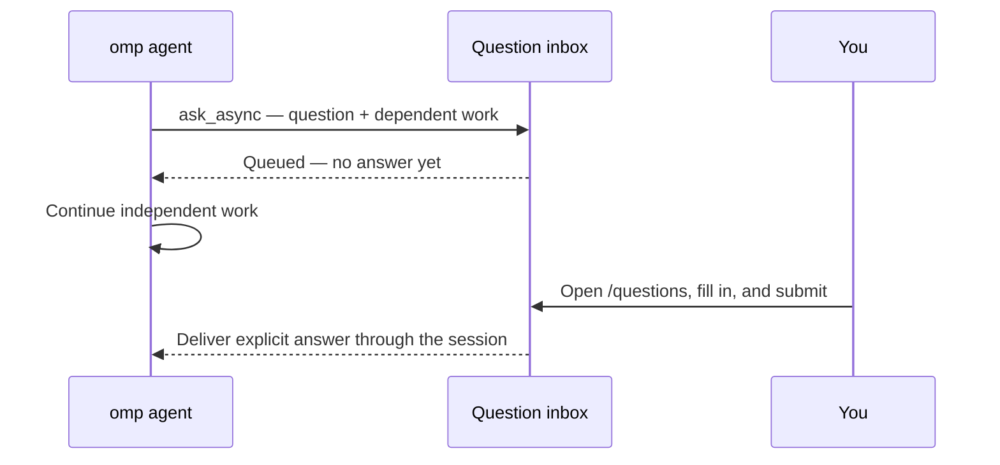

<p align="center">
  
</p>

<p align="center"><strong>Ask now. Keep moving.</strong></p>

<p align="center">
  Decisions belong in an inbox, not in the way.<br>
  Answer when you're ready. Let independent work continue.
</p>

<p align="center">
  <a href="#how-it-works">How it works</a> ·
  <a href="#get-started">Get started</a> ·
  <a href="#the-inbox">The inbox</a> ·
  <a href="#safety-and-delivery">Safety & delivery</a> ·
  <a href="#development">Development</a>
</p>

---

> **Better with [omp-away](https://github.com/kirisame-meguru/omp-away)** — Answer by voice from your phone while independent work continues. *Optional integration, in development.*

---

**Async Ask** gives [oh-my-pi](https://github.com/can1357/oh-my-pi) a session-local inbox for questions that don't need to stop everything. The agent queues a form through `ask_async`, identifies which work depends on your answer, and can continue unrelated tasks while you decide.

A standalone plugin using public extension APIs. **No core patches, separate Tern plugin, background service, or database.**

## Why Async Ask?

- **Keep work moving.** Asking a question returns immediately instead of holding a tool call open for your response.
- **Answer at your pace.** Native forms, one expanded question at a time, and separate **Pending** and **Answered** tabs.
- **Keep your draft.** Switch cards or tabs without losing input while the inbox stays open. “Skip for now” leaves the question unanswered.
- **Only ask for attention when needed.** The Questions widget appears only while questions are pending. Native Tern sessions also get a waiting-state icon.
- **Keep the workspace quiet.** New questions never open the inbox automatically. Resolving the last pending question closes it; `/questions` always opens history.

## How it works



A question waiting for input is **not** permission to proceed with its dependent work. The plugin adds guidance to keep useful independent work moving, but does not force extra agent turns or guarantee that the model will continue working.

## Get started

**Requirements:** OMP **19.x**, Bun **1.4.4+**, and a top-level interactive OMP session. Tern is optional: native rendering gets rich controls; ordinary terminals get a keyboard-driven fallback. Headless sessions and subagents are not supported.

### Install from source

```sh
git clone https://github.com/kirisame-meguru/omp-async-ask.git
cd omp-async-ask
bun install
omp plugin link .
```

Restart OMP after linking. The plugin enables `ask_async` in supported sessions; no additional configuration is required. Restart again after updating linked source.

To try it for one session without linking, run this from the checkout instead:

```sh
omp -e ./src/index.ts
```

### Use it

Ask the agent to queue non-blocking questions and continue independent work. When a question arrives, click **Questions** or run:

```text
/questions
```

The first pending question opens immediately. Fill in the form and choose **Send answer**, or **Skip for now** to leave it pending without submitting defaults.

## The inbox

| Area | Behavior |
|---|---|
| **Pending** | Unanswered questions only. Sending advances to the next one; skipped cards are amber. |
| **Answered** | Completed answers in green, delivery details, and clearly labeled withdrawn history. |
| **Drafts** | Preserved across cards and tabs while open. Closing with unsent drafts asks before discarding them. |
| **Automatic closing** | Resolving the final pending question closes the dialog. Skipping does not; a synchronous sending failure stays open for review. |
| **Questions widget** | Appears while anything is pending; disappears at zero. Use `/questions` to revisit history. |
| **Session attention** | Native Tern marks the session icon as waiting using its own theme color—red in Tern 0.9.30. |

The waiting indicator uses an independently owned [OSC 7501](https://www.superlogical.com/rex/docs/build/program-status) record. Clearing it does not clear OMP's own working, done, or approval status. It is also cleared on session changes, shutdown, or leaving native rendering.

### Keyboard controls

| Keys | Action |
|---|---|
| `Ctrl` + `Left` / `Right` | Switch Pending and Answered tabs |
| `Ctrl` + `Up` / `Down` | Move between questions in the current tab |
| `Escape` | Fold the active form; outside a form, close the inbox |
| `Up` / `Down`, then `Enter` | Select and expand folded cards |
| `r` | Open explicit resend confirmation when available, outside an active form |

## Safety and delivery

- **Only explicit submissions count.** Silence, skipped questions, and preselected defaults are never treated as answers or consent.
- **Existing controls stay intact.** Built-in Ask, approvals, explicit stops, and cost limits remain unchanged.
- **Answers stay with their session.** Questions and submitted answers are persisted in session history. Do not enter secrets; submitted values become part of the agent conversation.
- **Saved is not the same as delivered.** A matching conversation receipt marks an answer as recorded, not proof that the model read or acted on it.
- **Missing receipts do not demand another answer.** Delivery details remain in the answered card without adding a pending notification. Review `/questions` if delivery is uncertain.
- **No automatic resends.** A failed send leaves the answer saved for review. Retrying requires explicit action and can duplicate delivery; public extension APIs do not provide crash-proof exactly-once persistence or delivery.

For agent-facing usage and form rules, see the [tool instructions](src/prompts/tool.md). The tool supports `create`, `list`, and `withdraw`; it is not a scheduler or an approval bypass.

## Development

From the repository root, with Bun 1.4.4 or newer:

```sh
bun install
bun run check
bun test ./test
```

### Native UI acceptance

Run the interactive fixture in an **isolated Tern window**:

```sh
bun test/manual-ui.ts
```

It exercises real forms and answer delivery while simulated independent work continues. To check the real renderer's form layout, open the **Retention policy** form and run:

```sh
bun test/tern-layout.ts <control-port>
```

Use the control port of that isolated window, not a live working session.

### Repository map

| Path | Responsibility |
|---|---|
| [`src/index.ts`](src/index.ts) | Tool, command, session lifecycle, and widget visibility |
| [`src/ui.ts`](src/ui.ts) | Native and ordinary-terminal inbox, forms, tabs, and drafts |
| [`src/state.ts`](src/state.ts) · [`src/delivery.ts`](src/delivery.ts) | Session history, answer dispatch, and receipt reconciliation |
| [`src/attention.ts`](src/attention.ts) | Native session waiting-state indicator |
| [`src/prompts/`](src/prompts/) | Static model-facing instructions and goal-persistence policy |
| [`test/`](test/) | Regression tests, native surface harness, and acceptance fixtures |
| [`assets/`](assets/) | Geometric logo (SVG/PNG) and composed README hero |

Early design and implementation records live in [`docs/superpowers/`](docs/superpowers/). Their original checkout paths are historical; this package now lives independently of the OMP checkout. The native test harness is vendored from OMP under its MIT license and uses published package entrypoints.

---

[MIT licensed](LICENSE). Built for [oh-my-pi](https://github.com/can1357/oh-my-pi). Visual direction inspired by its [hero artwork](https://github.com/can1357/oh-my-pi/blob/main/assets/hero.png), with an original [geometric logo](assets/logo.svg) and independently composed banner.
